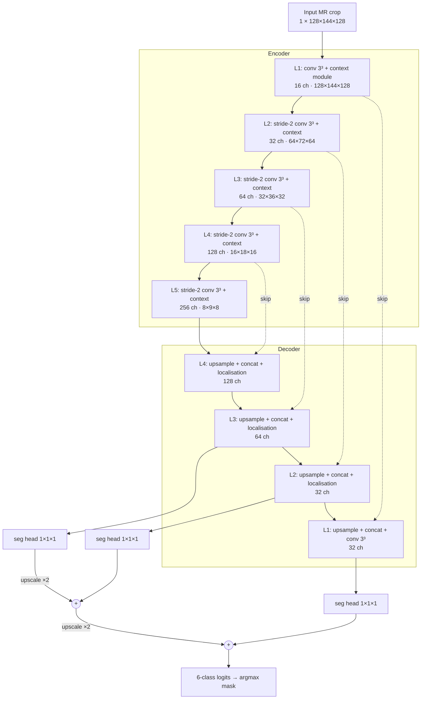
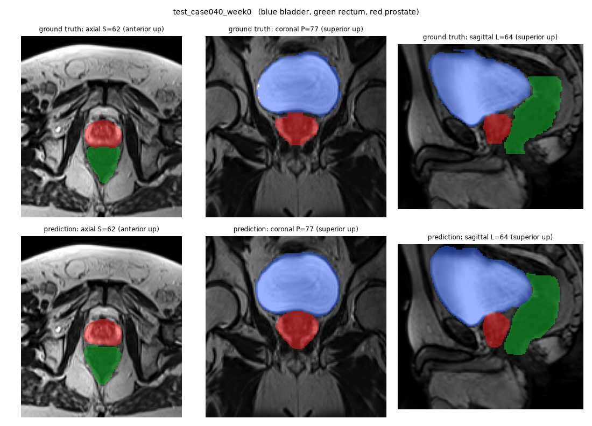

# 3D Improved U-Net for Prostate Segmentation on HipMRI

**Author:** Ruiqi Zuo (s4983299)

> Work in progress.

## 1. Problem and Algorithm

### 1.1 The problem

External-beam radiotherapy for prostate cancer is planned on MR images on which the prostate (the target) and the neighbouring organs at risk, the bladder and the rectum, must be contoured slice by slice. Under-contouring the prostate risks leaving tumour untreated, while over-contouring irradiates the bladder wall or rectal mucosa. This project builds a *draft* contouring assistant on the HipMRI study: 211 pelvic MR volumes from 38 patients, each labelled in 3D by an MR physicist into background, body, bone, bladder, rectum and prostate. The prostate is the hardest class: it covers only 0.43 % of the 2D slice pixels, and its two ends, the **apex** (inferior, against the pelvic floor) and the **base** (superior, against the bladder), fade into low-contrast tissue. A good global Dice score can therefore hide failures exactly where they matter clinically. The project asks whether a fully 3D model fixes these apex and base errors compared with a standard 2D U-Net, or whether it only improves the easy central slices at a much higher GPU cost (Section 7).

### 1.2 How the algorithm works

The proposed model is the **3D Improved U-Net** of Isensee et al. [2], which segments the whole pelvic volume at once instead of slice by slice. Each input is a fixed 128 × 144 × 128 crop around the pelvis at the scanner's native resolution (about 1.7 × 1.7 × 1.56 mm), normalised per volume. The encoder has five levels (16 to 256 channels). Each level starts with a 3 × 3 × 3 convolution (stride 2 below the first level, which halves the resolution) and adds a *context module*: a pre-activation residual block of two 3 × 3 × 3 convolutions with dropout in between. The decoder upsamples by nearest-neighbour repetition followed by a convolution, concatenates the matching encoder features (skip connection) and fuses them in a *localisation module* (a 3 × 3 × 3 convolution, then a 1 × 1 × 1 convolution that halves the channels). *Deep supervision* adds 1 × 1 × 1 segmentation heads at three decoder levels; the coarser maps are upscaled and summed into the final output, so gradient reaches the deeper decoder directly, which helps small structures. Instance normalisation replaces batch normalisation because a 3D batch holds only two volumes, and LeakyReLU replaces ReLU. The network (9.46 M parameters) is trained with soft Dice + cross-entropy loss, which counteracts the class imbalance, using bf16 mixed precision. Because every 3 × 3 × 3 kernel also sees the slices above and below, the model can use through-plane anatomy (for example, where the bladder begins) to decide where the prostate ends. The **baseline** is a standard 2D U-Net [1] (7.76 M parameters) trained on the 2D coronal slices of the same patients; its predictions are stacked back into 3D so that both models are scored on identical voxels.



*Figure 1. 3D Improved U-Net as implemented in [`modules.py`](modules.py). Context module = IN → LeakyReLU → conv 3³ → dropout 0.3 → IN → LeakyReLU → conv 3³, added to its input. Dotted arrows are skip connections; the three segmentation heads form the deep-supervision path.*



*Figure 2. Test volume (patient 040, week 0), never seen in training. Top row: ground truth; bottom row: 3D Improved U-Net prediction (bladder blue, rectum green, prostate red). Prostate Dice 0.874. Generated with `python predict.py --model improved3d`.*

## 2. Feasibility Review

*Written for the midpoint check-off. Evidence below is from the validation split and from random-input profiling; the test split has not been touched.*

> **Revisions after the check-off.** This is the review presented at the check-off, with factual corrections made once the 3D data had been audited:
> 1. The 3D audit (Section 2.3) showed that the 2D slices are *coronal* planes of the 3D volumes. As a result, labels 3 and 4 are bladder and rectum (the check-off draft had them swapped), and apex and base have to be defined along the inferior–superior axis of the volume.
> 2. The 3D input is a fixed crop at native resolution instead of a downsampled volume, so the parameter count was updated and the memory profile was re-measured.
> 3. The smoke test was re-run with the current script to add true apex / base Dice. The original check-off numbers are kept next to the re-run.
> 4. The outcome of each risk and plan is added in *italics*.
>
> The test split was used only for the final evaluation in Section 7.

### 2.1 User Need, Scope and Acceptance Criteria

**User:** a radiation therapist / MR physicist contouring the prostate and organs at risk (OARs) for external-beam radiotherapy planning.
**Prototype:** a volumetric *draft* contouring assistant that proposes body, bone, rectum, bladder and prostate masks for the specialist to review and edit. It is not intended for unsupervised clinical use.
**Dilemma addressed:** does true 3D context remove the base/apex and slice-transition errors of a 2D model, or does it only smooth easy central slices at several times the GPU cost?

Acceptance criteria, evaluated per volume on the same 9 held-out test volumes (patients 40–42) for both models, at the original label resolution:

| # | Criterion | Threshold |
|---|---|---|
| A1 | Prostate DSC, 3D Improved U-Net | ≥ 0.70 (spec target) |
| A2 | Prostate DSC at the **apex** and **base**: the 3 most inferior / superior prostate-bearing axial slices of each volume, plus any slice beyond them, so that over-extension is penalised | each ≥ 2D baseline + 0.05; central-slice DSC ≥ baseline − 0.01 |
| A3 | Slice continuity / leakage: disconnected prostate components per volume; prostate HD95 | both ≤ 2D baseline |
| A4 | Resources | training fits 8 GB locally (or one Rangpur A100 job); inference ≤ 1 s per volume; peak VRAM ratio vs 2D reported |

A2 and A3 are the real tests of the dilemma: passing A1 alone does not count as success.

### 2.2 Model Choice and Course Concepts

- **Data:** HipMRI 3D Nifti volumes (`semantic_MRs`, `semantic_labels_only`; 211 volumes, 38 patients), cropped to a fixed 128 × 144 × 128 box at native resolution (no resampling). The patient split mirrors the 2D `keras_slices_data` split (train 31 / validate 4 / test 3 patients), so the two models are compared on exactly the same patients. Per-volume z-score normalisation; 3D augmentation (left-right flip, small rotation/scale, intensity jitter) on training volumes only. 6 classes.
- **Model:** 3D Improved U-Net [2], **[Hard Difficulty]**: pre-activation residual context modules with dropout, stride-2 3D convolution downsampling, upsampling and localisation modules, and deep supervision (segmentation maps from three decoder levels summed), with instance norm and leaky ReLU.
- **Baseline:** standard 2D U-Net [1] (`UNet2D`, implemented, 7.76 M parameters). It has similar capacity to the 3D model (9.46 M), so differences come from spatial context, not model size.
- **Course concepts:** 3D convolution and receptive field (the kernel spans neighbouring slices, giving through-plane context at base/apex); residual learning; instance norm instead of batch norm because 3D batches are only 1–2 volumes; deep supervision for small structures; soft Dice + cross-entropy against class imbalance; mixed precision and cropping as memory/accuracy trade-offs; patient-level splitting for generalisation.

### 2.3 Preliminary Feasibility Evidence

Every number in this section can be reproduced with the scripts in [`scripts/`](scripts/): `audit2d.py`, `audit3d.py`, `smoke_test.py` and `profile3d.py` (usage in each file's docstring).

**2D data audit:** 12,660 slices from 211 scans of 38 patients. The prostate covers only **0.43 %** of pixels and appears in **36 %** of slices (12.9 % of prostate slices have < 100 px).

**3D data audit** (`semantic_MRs`, `semantic_labels_only`):
- **Files:** 211 image/label pairs. 210 volumes are 256 × 256 × 128 and one is 256 × 256 × 144. Orientation is LPS.
- **Voxel spacing:** 1.41–1.88 mm in-plane × 1.56 mm between axial slices (152 volumes are 1.68 × 1.68 × 1.56 mm).
- **Prostate extent:** 17–41 axial slices per volume (median 25).
- **Link to the 2D data:** the number in each 3D file name (e.g. `B006_Week0`) is the 2D case ID. Every 2D slice *k* is the left-right-flipped coronal plane `volume[:, 98 + k, :]` of its volume, an exact match for all 211 volumes. The 2D patient split therefore gives 191 / 11 / 9 volumes for train / validate / test.
- **2D coverage:** the 2D slices cover only coronal planes 98–157. In 4 train volumes part of the prostate lies outside this window; no validation or test volume is affected.
- **Label identity:** located in LPS coordinates, label 3 lies superior and anterior to the prostate (bladder), and label 4 lies posterior to it (rectum).
- **Crop:** bladder, rectum and prostate fit inside the fixed voxel box [64, 192) × [48, 192) × [0, 128) in every volume, except one train volume that loses its top 3 bladder slices. This box became the 3D input crop.

**2D baseline smoke test** (`scripts/smoke_test.py`): `UNet2D`, Dice + CE, Adam (lr 1e-3), batch 16, 5 epochs, seed 0, fp32, RTX 4070 Laptop GPU (8 GB). Prostate DSC on validation (4 patients / 11 scans), pooled over scans:

| Run | All | Coronal: anterior / central / posterior† | Axial: apex / central / base‡ | Other DSC: bladder / rectum / bone / body | Train VRAM | Epoch | Inference |
|---|---|---|---|---|---|---|---|
| Check-off | 0.843 | 0.655 / 0.864 / 0.578 | not computed | 0.903 / 0.876 / 0.935 / 0.978 | 1.5 GB | 69 s | 1.6 ms/slice |
| Re-run of current script | 0.854 | 0.708 / 0.875 / 0.578 | **0.695 / 0.872 / 0.561** | 0.885 / 0.889 / 0.936 / 0.978 | 1.50 GiB | –§ | –§ |

† The 3 most anterior / posterior prostate-bearing coronal slices of each scan. At the check-off these two columns were labelled "apex / base". That was wrong: the 2D slices are coronal, so slice index runs anterior to posterior, not inferior to superior.
‡ True apex / base: the 3 most inferior / superior prostate-bearing axial planes of each scan plus everything beyond them, the same definition as `evaluate.py`.
§ Not reported for the re-run, because the laptop GPU was throttled at the time (185–278 s per epoch). Speeds for the final models come from the Rangpur A100 (Section 7.2).

**3D Improved U-Net resource profile** (`scripts/profile3d.py`: random input, Adam, DiceCELoss, same 8 GB GPU). The check-off version of this table profiled downsampled inputs (64×128×128 and 128³) that were dropped after the 3D audit. This is the re-run for the two configurations actually considered:

| Input (L × P × S) | Precision | Batch | Peak training memory | Peak inference memory |
|---|---|---|---|---|
| **128×144×128 (final crop)** | **bf16** | **2** | **4.44 GiB** | **0.89 GiB** |
| 128×144×128 | fp32 | 2 | out of memory (> 8 GiB) | 1.07 GiB |
| 256×256×128 (whole volume) | bf16 | 1 | 7.80 GiB | 2.95 GiB |
| 256×256×128 | fp32 | 1 | 15.3 GiB* | 3.77 GiB |

\* Exceeds the 8 GB card; the WSL driver spilled into system RAM instead of failing.

**Interpretation:** the 2D pipeline works end to end and already reaches 0.85 global DSC on validation. However, its prostate DSC falls from 0.87 in the central axial planes to 0.70 at the apex and 0.56 at the base. Edge errors hidden by a high global Dice are exactly the dilemma, and they are where 3D context should help. 3D training fits the 8 GB laptop GPU only with both bf16 and the pelvic crop: 4.44 GiB at 128 × 144 × 128, while fp32 at the same size runs out of memory. In the final bf16 runs, 3D training used 4.4 GB against 0.85 GB for the 2D baseline, 5.2× the memory. The whole volume would need 7.8 GiB in bf16 and 15.3 GiB in fp32, so full-resolution training without cropping is only practical on a Rangpur A100.

### 2.4 Risks, Budget and Fallback

**Risks and mitigations**
- *3D data not yet audited* (Rangpur needs VPN): run `scripts/audit3d.py` before the check-off and fix the downsampling factor from the real volume shape. *Outcome: done (Section 2.3). The audit replaced downsampling with a native-resolution crop.*
- *Downsampling blurs millimetre boundaries:* upsample predictions and score at the original label resolution; compare against one full-resolution A100 run. *Outcome: avoided. No resampling is used, and all metrics are computed on native voxels.*
- *Only 191 training volumes from 31 patients:* 3D models can overfit. → Augmentation, dropout, early stopping on validation DSC. *Outcome: used augmentation, dropout 0.3 and best-validation checkpointing. The best validation epochs were 38 and 74 of 150.*
- *Small evaluation sets* (4 / 3 patients): → report per-volume DSC spread and train 2 seeds per model. *Outcome: done. Section 7 reports per-patient results and the gap between the two runs of each model.*
- *Label identity:* labels 3 (rectum) and 4 (bladder) were inferred from anatomy; confirm with teaching staff. *Outcome: resolved by the 3D audit. Label 3 is bladder and label 4 is rectum, so the check-off draft had them the wrong way round.*

**Budget:** ≈ 0.4 s/iteration × ~96 iterations/epoch ≈ 40 s/epoch at 128³ → ≈ 3 GPU-h per 3D run (300 epochs). With 2 seeds, the 2D baseline and one full-resolution A100 ablation, the total is ≈ 10 GPU-h. Downsampled volumes (≈ 1.8 GB in float32) are cached in RAM so that Nifti loading does not bottleneck the GPU. *Outcome: on an A100 a 3D epoch took 16.9 s, so a 150-epoch run took 42 min. 300 epochs were unnecessary because the best validation epoch came well before 150. The cropped volumes are cached as `.npy` files (≈ 2.5 GB) instead of in RAM.*

**Next experiment:** run the 3D audit, write a 3D `Dataset` with the mirrored patient split, train the 3D Improved U-Net for 20 epochs at 128³, and confirm that validation prostate DSC is rising before committing to the full 300-epoch runs. *Outcome: the 20-epoch run reached validation prostate DSC 0.858, which justified the 150-epoch runs.*

**Fallback:** if memory or time runs out, train on 96³–128³ patches with sliding-window inference, and reduce base filters from 16 to 8. If the 3D model still cannot reach A1 in time, fall back to the 2D Improved U-Net [Normal], reusing the working 2D pipeline. If 3D passes A1 but not A2, the recommendation becomes: auto-draft central slices, and flag the outer 3 prostate slices for mandatory manual contouring. *Outcome: no fallback was needed for memory or A1. The last case, passing A1 but not A2, is what happened (Section 7.4).*

## 3. Dependencies and Reproducibility

### 3.1 Software

```bash
conda create -n torch python=3.11 pip -y && conda activate torch
pip install torch==2.13.0 torchvision==0.28.0 --index-url https://download.pytorch.org/whl/cu130
pip install -r requirements.txt
```

| Package | Version | Used for |
|---|---|---|
| Python | 3.11.15 | |
| PyTorch | 2.13.0 (CUDA 13.0, cuDNN 9.20) | all models, training and inference. `modules.py` uses PyTorch only |
| torchvision | 0.28.0 | joint image / mask augmentation of 2D slices (`transforms.v2`) |
| nibabel | 5.4.2 | reading Nifti slices and volumes, writing predicted masks |
| NumPy | 2.4.6 | data loading and evaluation (not used by the models) |
| SciPy | 1.17.1 | HD95 distance transforms and connected components in `evaluate.py` |
| Matplotlib | 3.11.1 | training curves and figures |

The versions above are from the local environment (WSL2 Ubuntu 22.04, NVIDIA driver 616.56). The Rangpur environment used for the A100 runs: <!-- TODO: fill from Rangpur --> **to be filled**.

### 3.2 Hardware and training runs

All reported results come from four training runs, two seeds per model:

| Run | Hardware | Epochs | Time / epoch | Total | Best validation epoch | Peak training memory |
|---|---|---|---|---|---|---|
| 2D U-Net, seed 0 | Rangpur A100-PCIE-40GB | 30 | 40.0 s | 20 min | 14 | 0.85 GB |
| 2D U-Net, seed 1 | RTX 4070 Laptop GPU, 8 GB | 30 | 199 s* | 99 min | 23 | 0.86 GB |
| 3D Improved U-Net, seed 0 | Rangpur A100-PCIE-40GB | 150 | 16.9 s | 42 min | 38 | 4.44 GB |
| 3D Improved U-Net, seed 1 | Rangpur A100-PCIE-40GB | 150 | 16.9 s | 42 min | 74 | 4.44 GB |

\* The laptop GPU was throttled during this run, so its time is not comparable with the A100 times.

Data audits, the smoke test, evaluation (`evaluate.py`) and prediction (`predict.py`) ran on the laptop GPU.

### 3.3 Training configuration

Both models share the following settings:
- **Optimiser:** Adam with weight decay 1e-5, and a cosine learning-rate schedule that decays to 0 over the run.
- **Loss:** soft Dice (foreground classes, pooled over the batch) + cross-entropy, equally weighted.
- **Precision:** bf16 autocast.
- **Checkpoint:** the epoch with the highest validation prostate Dice averaged per scan. The test split is evaluated once, at the end.

| | 2D U-Net | 3D Improved U-Net |
|---|---|---|
| Input | 1 × 256 × 128 coronal slice, per-slice z-score | 1 × 128 × 144 × 128 crop, per-volume z-score |
| Batch size | 16 | 2 |
| Learning rate | 1e-3 | 5e-4 (as in [2]) |
| Epochs | 30 | 150 |
| Augmentation (train only) | left-right flip, rotation ±10°, translation ±5 %, scale 0.9–1.1 | left-right flip, rotation ±10° about each axis, scale 0.9–1.1, intensity × U(0.9, 1.1) + U(−0.1, 0.1) |

### 3.4 Determinism and what is not in the repository

- **Seeds:** `train.py --seed` seeds Python, NumPy and PyTorch (CPU and CUDA). Augmentation draws only from the PyTorch generator, and DataLoader workers derive their seeds from it.
- **Remaining non-determinism:** cuDNN's deterministic mode is not enabled because it slows training, and bf16 reductions differ between GPUs. Re-running the same command therefore reproduces results to about ±0.01 Dice, not bit-exactly. For example, the smoke-test re-run gave 0.854 against 0.843 at the check-off (Section 2.3). For this reason every conclusion in Section 7 is based on two seeds per model and is compared with the run-to-run gap.
- **Data split:** the official `keras_slices_data` split is used. The 3D split is defined in code (`dataset.VAL_CASES`, `dataset.TEST_CASES`), and `check_patient_disjoint` verifies on every run that no patient appears in two splits.
- **Not committed:** the datasets and model weights (`*.pth`) are excluded by `.gitignore`, as the assessment requires. The data is on Rangpur under `/home/groups/comp3710/HipMRI_Study_open/` (`keras_slices_data`, `semantic_MRs`, `semantic_labels_only`). Section 5 gives the commands that regenerate every checkpoint and result.

## 4. Data Pre-processing and Splits
<!-- TODO: normalisation, augmentation, patient-level split justification -->

## 5. Usage
<!-- TODO: how to run train.py and predict.py -->

## 6. Results
<!-- TODO: example inputs/outputs, training curves -->

## 7. Open Research Dilemma Investigation
### 7.1 Baseline Comparison (2D U-Net vs 3D Improved U-Net)
### 7.2 Resource Profiling
### 7.3 Failure Case Autopsy
### 7.4 Recommendation to Project Manager

## 8. Artificial Intelligence Usage Disclosure
<!-- TODO: tools used, tasks assisted, how outputs were verified -->

## References

[1] O. Ronneberger, P. Fischer, and T. Brox, "U-Net: Convolutional networks for biomedical image segmentation," in *Proc. MICCAI*, 2015, pp. 234–241.

[2] F. Isensee, P. Kickingereder, W. Wick, M. Bendszus, and K. H. Maier-Hein, "Brain tumor segmentation and radiomics survival prediction: Contribution to the BRATS 2017 challenge," in *Brainlesion: Glioma, Multiple Sclerosis, Stroke and TBI*, 2018, pp. 287–297.
