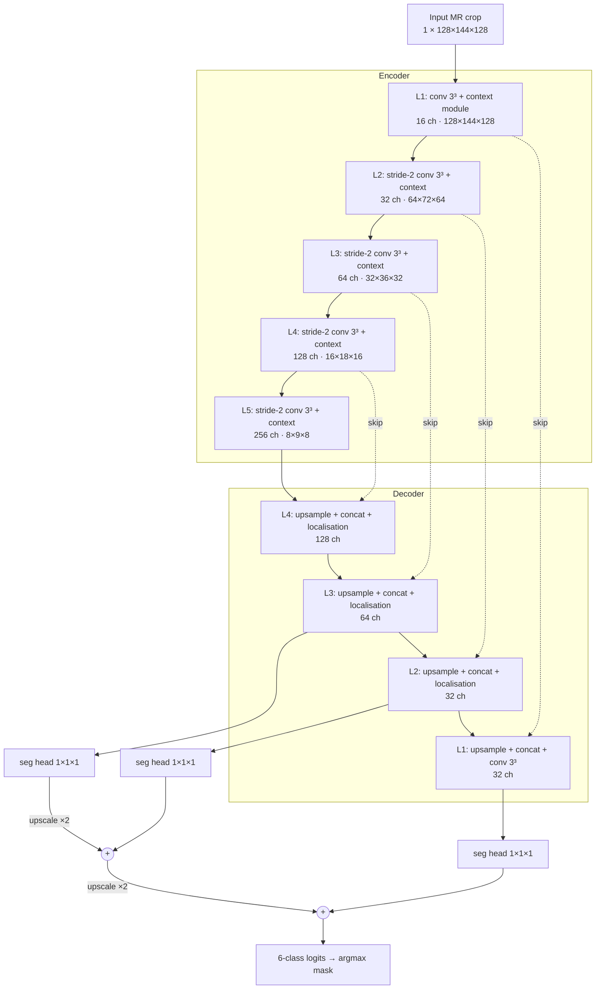
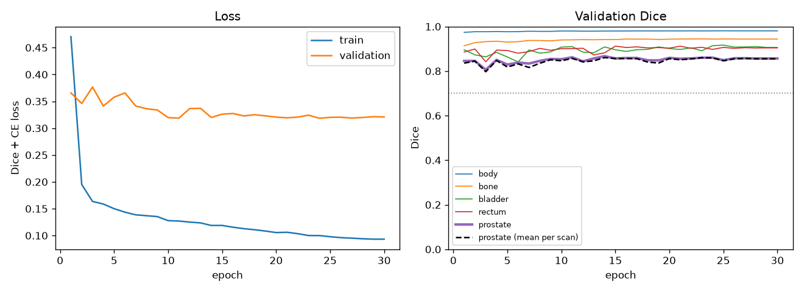
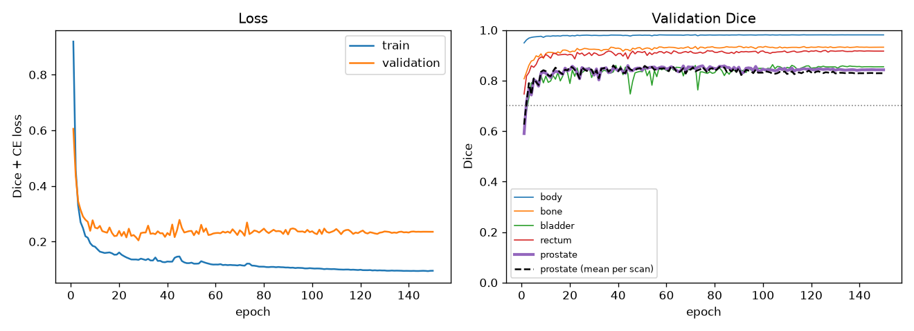
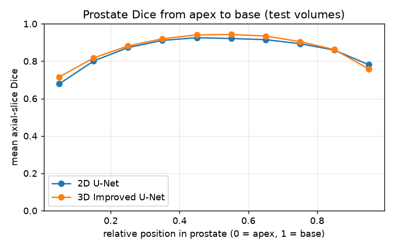
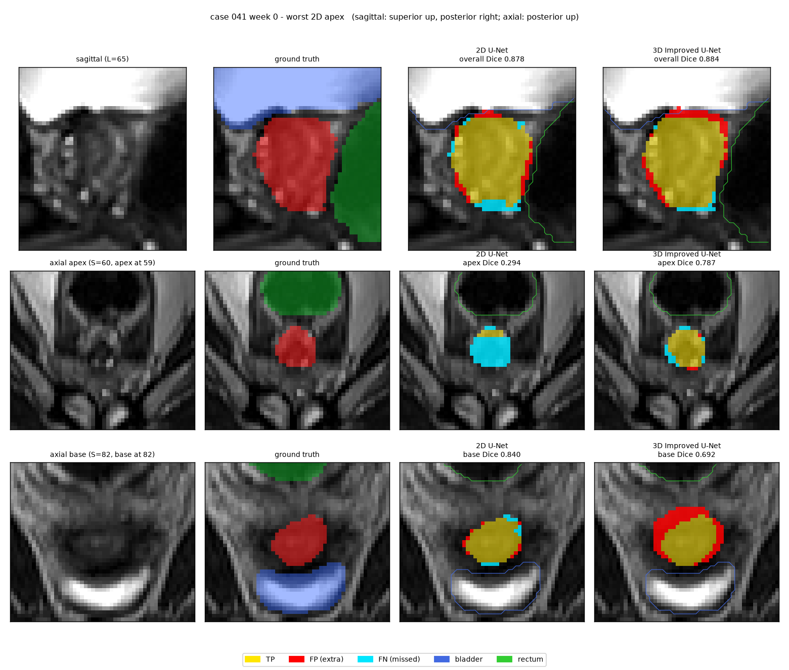
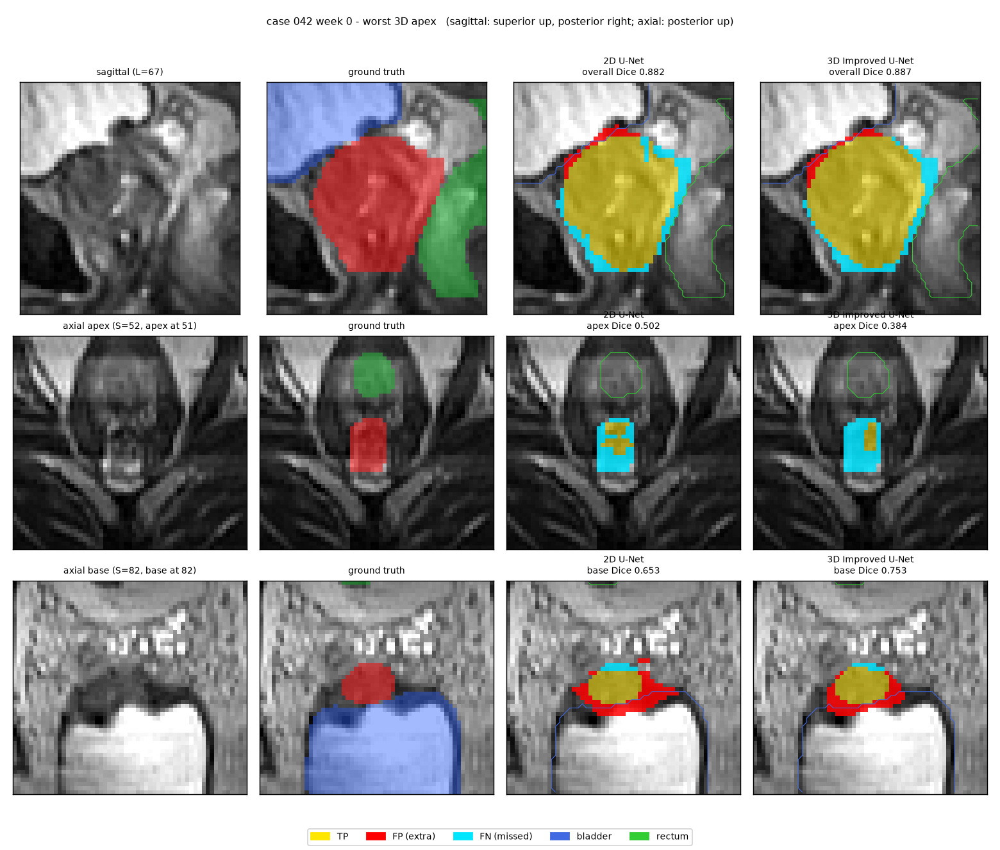
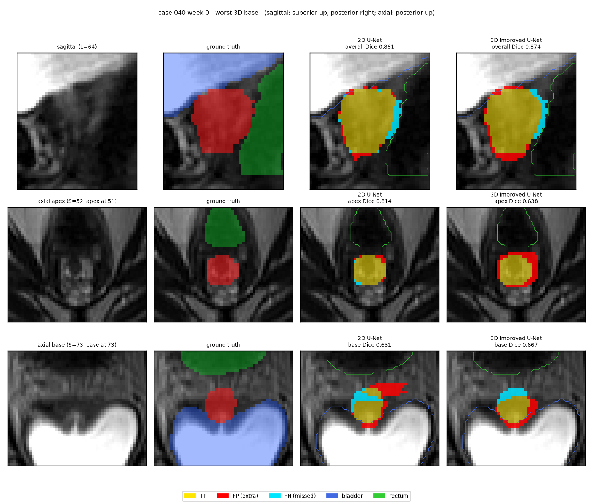
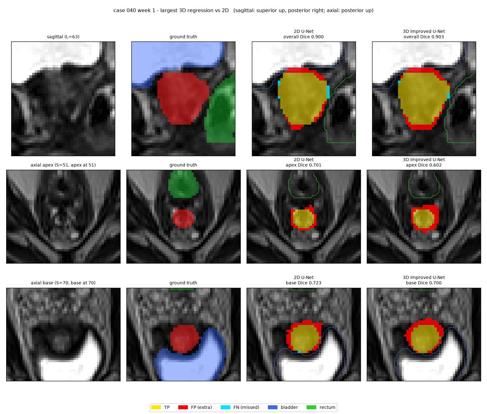

# 3D Improved U-Net for Prostate Segmentation on HipMRI

**Author:** Ruiqi Zuo (s4983299)

## 1. Problem and Algorithm

### 1.1 The problem

External-beam radiotherapy for prostate cancer is planned on MR images on which the prostate (the target) and the neighbouring organs at risk, the bladder and the rectum, must be contoured slice by slice. Under-contouring the prostate risks leaving tumour untreated, while over-contouring irradiates the bladder wall or rectal mucosa. This project builds a *draft* contouring assistant on the HipMRI study [3]: 211 pelvic MR volumes from 38 patients, each labelled in 3D by an MR physicist into background, body, bone, bladder, rectum and prostate. The prostate is the hardest class: it covers only 0.43 % of the 2D slice pixels, and its two ends, the **apex** (inferior, against the pelvic floor) and the **base** (superior, against the bladder), fade into low-contrast tissue. A good global Dice score can therefore hide failures exactly where they matter clinically. The project asks whether a fully 3D model fixes these apex and base errors compared with a standard 2D U-Net, or whether it only improves the easy central slices at a much higher GPU cost (Section 7).

### 1.2 How the algorithm works

The proposed model is the **3D Improved U-Net** of Isensee et al. [2], which segments the whole pelvic volume at once instead of slice by slice. Each input is a fixed 128 × 144 × 128 crop around the pelvis at the scanner's native resolution (about 1.7 × 1.7 × 1.56 mm), normalised per volume. The encoder has five levels (16 to 256 channels). Each level starts with a 3 × 3 × 3 convolution (stride 2 below the first level, which halves the resolution) and adds a *context module*: a pre-activation residual block of two 3 × 3 × 3 convolutions with dropout in between. The decoder upsamples by nearest-neighbour repetition followed by a convolution, concatenates the matching encoder features (skip connection) and fuses them in a *localisation module* (a 3 × 3 × 3 convolution, then a 1 × 1 × 1 convolution that halves the channels). *Deep supervision* adds 1 × 1 × 1 segmentation heads at three decoder levels; the coarser maps are upscaled and summed into the final output, so gradient reaches the deeper decoder directly, which helps small structures. Instance normalisation replaces batch normalisation because a 3D batch holds only two volumes, and LeakyReLU replaces ReLU. The network (9.46 M parameters) is trained with soft Dice + cross-entropy loss, which counteracts the class imbalance, using bf16 mixed precision. Because every 3 × 3 × 3 kernel also sees the slices above and below, the model can use through-plane anatomy (for example, where the bladder begins) to decide where the prostate ends. The **baseline** is a standard 2D U-Net [1] (7.76 M parameters) trained on the 2D coronal slices of the same patients; its predictions are stacked back into 3D so that both models are scored on identical voxels.



*Figure 1. 3D Improved U-Net as implemented in [`modules.py`](modules.py). Context module = IN → LeakyReLU → conv 3³ → dropout 0.3 → IN → LeakyReLU → conv 3³, added to its input. Dotted arrows are skip connections; the three segmentation heads form the deep-supervision path.*


*Figure 2. Test volume (patient 040, week 0), never seen in training. Top row: ground truth; bottom row: 3D Improved U-Net prediction (bladder blue, rectum green, prostate red). Prostate Dice 0.874. Generated with `python predict.py --model improved3d`.*

## 2. Feasibility Review

*Written for the midpoint check-off. Evidence below is from the validation split and from random-input profiling; the test split has not been touched.*

> **Revisions after the check-off.** This is the review presented at the check-off, with factual corrections made once the 3D data had been audited:
> 1. The 3D audit (Section 2.3) showed that the 2D slices are *coronal* planes of the 3D volumes. As a result, labels 3 and 4 are bladder and rectum (the check-off draft had them swapped), and apex and base have to be defined along the inferior–superior axis of the volume.
> 2. The 3D input is a fixed crop at native resolution instead of a downsampled volume, so the parameter count was updated and the memory profile was re-measured.
> 3. The smoke test was re-run with the current script to add true apex / base Dice. The original check-off numbers are kept next to the re-run.
> 4. The outcome of each risk and plan is added in *italics*.
>
> The test split was used only for the final evaluation in Section 7.

### 2.1 User Need, Scope and Acceptance Criteria

**User:** a radiation therapist / MR physicist contouring the prostate and organs at risk (OARs) for external-beam radiotherapy planning.

**Prototype:** a volumetric *draft* contouring assistant that proposes body, bone, rectum, bladder and prostate masks for the specialist to review and edit. It is not intended for unsupervised clinical use.

**Dilemma addressed:** does true 3D context remove the base/apex and slice-transition errors of a 2D model, or does it only smooth easy central slices at several times the GPU cost?

Acceptance criteria, evaluated per volume on the same 9 held-out test volumes (patients 40–42) for both models, at the original label resolution:

| # | Criterion | Threshold |
|---|---|---|
| A1 | Prostate DSC, 3D Improved U-Net | ≥ 0.70 (spec target) |
| A2 | Prostate DSC at the **apex** and **base**: the 3 most inferior / superior prostate-bearing axial slices of each volume, plus any slice beyond them, so that over-extension is penalised | each ≥ 2D baseline + 0.05; central-slice DSC ≥ baseline − 0.01 |
| A3 | Slice continuity / leakage: disconnected prostate components per volume; prostate HD95 | both ≤ 2D baseline |
| A4 | Resources | training fits 8 GB locally (or one Rangpur A100 job); inference ≤ 1 s per volume; peak VRAM ratio vs 2D reported |

A2 and A3 are the real tests of the dilemma: passing A1 alone does not count as success.

### 2.2 Model Choice and Course Concepts

- **Data:** HipMRI 3D Nifti volumes (`semantic_MRs`, `semantic_labels_only`; 211 volumes, 38 patients), cropped to a fixed 128 × 144 × 128 box at native resolution (no resampling). The patient split mirrors the 2D `keras_slices_data` split (train 31 / validate 4 / test 3 patients), so the two models are compared on exactly the same patients. Per-volume z-score normalisation; 3D augmentation (left-right flip, small rotation/scale, intensity jitter) on training volumes only. 6 classes.
- **Model:** 3D Improved U-Net [2], **[Hard Difficulty]**: pre-activation residual context modules with dropout, stride-2 3D convolution downsampling, upsampling and localisation modules, and deep supervision (segmentation maps from three decoder levels summed), with instance norm and leaky ReLU.
- **Baseline:** standard 2D U-Net [1] (`UNet2D`, implemented, 7.76 M parameters). It has similar capacity to the 3D model (9.46 M), so differences come from spatial context, not model size.
- **Course concepts:** 3D convolution and receptive field (the kernel spans neighbouring slices, giving through-plane context at base/apex); residual learning; instance norm instead of batch norm because 3D batches are only 1–2 volumes; deep supervision for small structures; soft Dice + cross-entropy against class imbalance; mixed precision and cropping as memory/accuracy trade-offs; patient-level splitting for generalisation.

### 2.3 Preliminary Feasibility Evidence

Every number in this section can be reproduced with the scripts in [`scripts/`](scripts/): `audit2d.py`, `audit3d.py`, `smoke_test.py` and `profile3d.py` (usage in each file's docstring).

**2D data audit:** 12,660 slices from 211 scans of 38 patients. The prostate covers only **0.43 %** of pixels and appears in **36 %** of slices (12.9 % of prostate slices have < 100 px).

**3D data audit** (`semantic_MRs`, `semantic_labels_only`):
- **Files:** 211 image/label pairs. 210 volumes are 256 × 256 × 128 and one is 256 × 256 × 144. Orientation is LPS.
- **Voxel spacing:** 1.41–1.88 mm in-plane × 1.56 mm between axial slices (152 volumes are 1.68 × 1.68 × 1.56 mm).
- **Prostate extent:** 17–41 axial slices per volume (median 25).
- **Link to the 2D data:** the number in each 3D file name (e.g. `B006_Week0`) is the 2D case ID. Every 2D slice *k* is the left-right-flipped coronal plane `volume[:, 98 + k, :]` of its volume, an exact match for all 211 volumes. The 2D patient split therefore gives 191 / 11 / 9 volumes for train / validate / test.
- **2D coverage:** the 2D slices cover only coronal planes 98–157. In 4 train volumes part of the prostate lies outside this window; no validation or test volume is affected.
- **Label identity:** located in LPS coordinates, label 3 lies superior and anterior to the prostate (bladder), and label 4 lies posterior to it (rectum).
- **Crop:** bladder, rectum and prostate fit inside the fixed voxel box [64, 192) × [48, 192) × [0, 128) in every volume, except one train volume that loses its top 3 bladder slices. This box became the 3D input crop.

**2D baseline smoke test** (`scripts/smoke_test.py`): `UNet2D`, Dice + CE, Adam (lr 1e-3), batch 16, 5 epochs, seed 0, fp32, RTX 4070 Laptop GPU (8 GB). Prostate DSC on validation (4 patients / 11 scans), pooled over scans:

| Run | All | Coronal: anterior / central / posterior† | Axial: apex / central / base‡ | Other DSC: bladder / rectum / bone / body | Train VRAM | Epoch | Inference |
|---|---|---|---|---|---|---|---|
| Check-off | 0.843 | 0.655 / 0.864 / 0.578 | not computed | 0.903 / 0.876 / 0.935 / 0.978 | 1.5 GiB | 69 s | 1.6 ms/slice |
| Re-run of current script | 0.854 | 0.708 / 0.875 / 0.578 | **0.695 / 0.872 / 0.561** | 0.885 / 0.889 / 0.936 / 0.978 | 1.50 GiB | –§ | –§ |

† The 3 most anterior / posterior prostate-bearing coronal slices of each scan. At the check-off these two columns were labelled "apex / base". That was wrong: the 2D slices are coronal, so slice index runs anterior to posterior, not inferior to superior.

‡ True apex / base: the 3 most inferior / superior prostate-bearing axial planes of each scan plus everything beyond them, the same definition as `evaluate.py`.

§ Not reported for the re-run, because the laptop GPU was throttled at the time (185–278 s per epoch). Speeds for the final models come from the Rangpur A100 (Section 7.2).

**3D Improved U-Net resource profile** (`scripts/profile3d.py`: random input, Adam, DiceCELoss, same 8 GB GPU). The check-off version of this table profiled downsampled inputs (64×128×128 and 128³) that were dropped after the 3D audit. This is the re-run for the two configurations actually considered:

| Input (L × P × S) | Precision | Batch | Peak training memory | Peak inference memory |
|---|---|---|---|---|
| **128×144×128 (final crop)** | **bf16** | **2** | **4.44 GiB** | **0.89 GiB** |
| 128×144×128 | fp32 | 2 | out of memory (> 8 GiB) | 1.07 GiB |
| 256×256×128 (whole volume) | bf16 | 1 | 7.80 GiB | 2.95 GiB |
| 256×256×128 | fp32 | 1 | 15.3 GiB* | 3.77 GiB |

\* Exceeds the 8 GB card; the WSL driver spilled into system RAM instead of failing.

**Interpretation:** the 2D pipeline works end to end and already reaches 0.85 global DSC on validation. However, its prostate DSC falls from 0.87 in the central axial planes to 0.70 at the apex and 0.56 at the base. Edge errors hidden by a high global Dice are exactly the dilemma, and they are where 3D context should help. 3D training fits the 8 GB laptop GPU only with both bf16 and the pelvic crop: 4.44 GiB at 128 × 144 × 128, while fp32 at the same size runs out of memory. In the final bf16 runs, 3D training used 4.44 GiB against 0.85 GiB for the 2D baseline, 5.2× the memory. The whole volume would need 7.8 GiB in bf16 and 15.3 GiB in fp32, so full-resolution training without cropping is only practical on a Rangpur A100.

### 2.4 Risks, Budget and Fallback

**Risks and mitigations**
- *3D data not yet audited* (Rangpur needs VPN): run `scripts/audit3d.py` before the check-off and fix the downsampling factor from the real volume shape. *Outcome: done (Section 2.3). The audit replaced downsampling with a native-resolution crop.*
- *Downsampling blurs millimetre boundaries:* upsample predictions and score at the original label resolution; compare against one full-resolution A100 run. *Outcome: avoided. No resampling is used, and all metrics are computed on native voxels.*
- *Only 191 training volumes from 31 patients:* 3D models can overfit. → Augmentation, dropout, early stopping on validation DSC. *Outcome: used augmentation, dropout 0.3 and best-validation checkpointing. The best validation epochs were 38 and 74 of 150.*
- *Small evaluation sets* (4 / 3 patients): → report per-volume DSC spread and train 2 seeds per model. *Outcome: done. Section 7 reports per-patient results and the gap between the two runs of each model.*
- *Label identity:* labels 3 (rectum) and 4 (bladder) were inferred from anatomy; confirm with teaching staff. *Outcome: resolved by the 3D audit. Label 3 is bladder and label 4 is rectum, so the check-off draft had them the wrong way round.*

**Budget:** ≈ 0.4 s/iteration × ~96 iterations/epoch ≈ 40 s/epoch at 128³ → ≈ 3 GPU-h per 3D run (300 epochs). With 2 seeds, the 2D baseline and one full-resolution A100 ablation, the total is ≈ 10 GPU-h. Downsampled volumes (≈ 1.8 GB in float32) are cached in RAM so that Nifti loading does not bottleneck the GPU. *Outcome: on an A100 a 3D epoch took 16.9 s, so a 150-epoch run took 42 min. 300 epochs were unnecessary because the best validation epoch came well before 150. The cropped volumes are cached as `.npy` files (≈ 2.5 GB) instead of in RAM.*

**Next experiment:** run the 3D audit, write a 3D `Dataset` with the mirrored patient split, train the 3D Improved U-Net for 20 epochs at 128³, and confirm that validation prostate DSC is rising before committing to the full 300-epoch runs. *Outcome: the 20-epoch run reached validation prostate DSC 0.858, which justified the 150-epoch runs.*

**Fallback:** if memory or time runs out, train on 96³–128³ patches with sliding-window inference, and reduce base filters from 16 to 8. If the 3D model still cannot reach A1 in time, fall back to the 2D Improved U-Net [Normal], reusing the working 2D pipeline. If 3D passes A1 but not A2, the recommendation becomes: auto-draft central slices, and flag the outer 3 prostate slices for mandatory manual contouring. *Outcome: no fallback was needed for memory or A1. The last case, passing A1 but not A2, is what happened (Section 7.4).*

## 3. Dependencies and Reproducibility

### 3.1 Software

```bash
conda create -n torch python=3.11 pip -y && conda activate torch
pip install torch==2.13.0 torchvision==0.28.0 --index-url https://download.pytorch.org/whl/cu130
pip install -r requirements.txt
```

| Package | Version | Used for |
|---|---|---|
| Python | 3.11.15 | |
| PyTorch | 2.13.0 (CUDA 13.0, cuDNN 9.20) | all models, training and inference. `modules.py` uses PyTorch only |
| torchvision | 0.28.0 | joint image / mask augmentation of 2D slices (`transforms.v2`) |
| nibabel | 5.4.2 | reading Nifti slices and volumes, writing predicted masks |
| NumPy | 2.4.6 | data loading and evaluation (not used by the models) |
| SciPy | 1.17.1 | HD95 distance transforms and connected components in `evaluate.py` |
| Matplotlib | 3.11.1 | training curves and figures |

The versions above are from the local environment (WSL2 Ubuntu 22.04, NVIDIA driver 616.56). The Rangpur `torch` environment used for the A100 runs has the same versions (Python 3.11.15, PyTorch 2.13.0 + CUDA 13.0, cuDNN 9.20, torchvision 0.28.0, nibabel 5.4.2, NumPy 2.4.6), except Matplotlib 3.11.2. SciPy is only needed by `evaluate.py`, which ran locally.

### 3.2 Hardware and training runs

All reported results come from four training runs, two seeds per model:

| Run | Hardware | Epochs | Time / epoch | Total | Best validation epoch | Peak training memory |
|---|---|---|---|---|---|---|
| 2D U-Net, seed 0 | Rangpur A100-PCIE-40GB | 30 | 40.0 s | 20 min | 14 | 0.85 GiB |
| 2D U-Net, seed 1 | RTX 4070 Laptop GPU, 8 GB | 30 | 199 s* | 99 min | 23 | 0.86 GiB |
| 3D Improved U-Net, seed 0 | Rangpur A100-PCIE-40GB | 150 | 16.9 s | 42 min | 38 | 4.44 GiB |
| 3D Improved U-Net, seed 1 | Rangpur A100-PCIE-40GB | 150 | 16.9 s | 42 min | 74 | 4.44 GiB |

\* The laptop GPU was throttled during this run, so its time is not comparable with the A100 times.

Data audits, the smoke test, evaluation (`evaluate.py`) and prediction (`predict.py`) ran on the laptop GPU.

### 3.3 Training configuration

Both models share the following settings:
- **Optimiser:** Adam with weight decay 1e-5, and a cosine learning-rate schedule that decays to 0 over the run.
- **Loss:** soft Dice (foreground classes, pooled over the batch) + cross-entropy, equally weighted.
- **Precision:** bf16 autocast.
- **Checkpoint:** the epoch with the highest validation prostate Dice averaged per scan. The test split is evaluated once, at the end.

| | 2D U-Net | 3D Improved U-Net |
|---|---|---|
| Input | 1 × 256 × 128 coronal slice, per-slice z-score | 1 × 128 × 144 × 128 crop, per-volume z-score |
| Batch size | 16 | 2 |
| Learning rate | 1e-3 | 5e-4 (as in [2]) |
| Epochs | 30 | 150 |
| Augmentation (train only) | left-right flip, rotation ±10°, translation ±5 %, scale 0.9–1.1 | left-right flip, rotation ±10° about each axis, scale 0.9–1.1, intensity × U(0.9, 1.1) + U(−0.1, 0.1) |

### 3.4 Determinism and what is not in the repository

- **Seeds:** `train.py --seed` seeds Python, NumPy and PyTorch (CPU and CUDA). Augmentation draws only from the PyTorch generator, and DataLoader workers derive their seeds from it.
- **Remaining non-determinism:** cuDNN's deterministic mode is not enabled because it slows training, and bf16 reductions differ between GPUs. Re-running the same command therefore reproduces results to about ±0.01 Dice, not bit-exactly. For example, the smoke-test re-run gave 0.854 against 0.843 at the check-off (Section 2.3). For this reason every conclusion in Section 7 is based on two seeds per model and is compared with the run-to-run gap.
- **Data split:** the official `keras_slices_data` split is used. The 3D split is defined in code (`dataset.VAL_CASES`, `dataset.TEST_CASES`), and `check_patient_disjoint` verifies on every run that no patient appears in two splits.
- **Not committed:** the datasets and model weights (`*.pth`) are excluded by `.gitignore`, as the assessment requires. The data is on Rangpur under `/home/groups/comp3710/HipMRI_Study_open/` (`keras_slices_data`, `semantic_MRs`, `semantic_labels_only`). Section 5 gives the commands that regenerate every checkpoint and result.

## 4. Data Pre-processing and Splits

The facts about the data (shapes, spacing, orientation, class balance) are in Section 2.3. This section describes what is done to the data and why. All of it is implemented in [`dataset.py`](dataset.py).

Both models use the same two encodings:
- **Intensities:** z-score normalisation, per slice for the 2D model (Section 4.2) and per volume for the 3D model (Section 4.3).
- **Masks:** integer label maps (0–5) during loading, cropping and augmentation, so that nearest-neighbour resampling always gives valid labels. The loss expands them into six one-hot channels (`F.one_hot` in `DiceLoss`, [`modules.py`](modules.py)), and the soft Dice term compares these channels with the softmax output class by class. The cross-entropy term takes the label map directly.

### 4.1 Patient-level split

| Split | Patients | Scans (3D volumes) | 2D slices | Used for |
|---|---|---|---|---|
| Train | 31 (004–035, no 034) | 191 | 11,460 | gradient updates |
| Validate | 4 (036–039) | 11 | 660 | choosing the checkpoint |
| Test | 3 (040–042) | 9 | 540 | final evaluation only (Section 7) |

- **The patient is the unit of the split.** 22 of the 38 patients have 8 weekly scans of the same anatomy, and neighbouring slices of one scan are almost identical. A split by slice or by scan would put near-copies of a test patient into training and inflate the test Dice.
- **The official `keras_slices_data` split is used as given.** `check_patient_disjoint` confirms on every run that no patient is in two splits. The 3D volumes are assigned to the same splits through the case ID in their file names (Section 2.3). Both models are therefore trained, selected and tested on identical patients, which a paired comparison requires.
- **The validation split only selects the checkpoint** (highest prostate Dice averaged per scan), and it was used to check that the 20-epoch 3D pilot was learning. No hyperparameter search was run. The test split is scored only with the selected checkpoint of each run, and nothing was chosen based on test results.
- **Limitation: the held-out splits are small and unbalanced.** Patient 039 contributes 8 of the 11 validation scans, and patient 040 contributes 7 of the 9 test scans. The test set therefore holds 3 independent patients, not 9 independent samples, and a mean over the 9 volumes mostly reflects patient 040. For this reason Section 7 reports results per patient and for two seeds. Patient-level cross-validation would give a tighter estimate, but it would cost about five times the GPU time and would no longer use the course's common split.

### 4.2 2D baseline: per-slice pre-processing

Applied in `HipMRI2DDataset.__getitem__`, in this order:

1. **Unify the size:** centre-crop or zero-pad every slice to 256 × 128. The only slices of a different size are the 60 slices of one training scan (case 019, week 1, with 144 axial planes), which lose 8 axial planes at each end. Cropping is used instead of resizing because it keeps the mask labels as integers and keeps the image and mask aligned pixel for pixel.
2. **Augment (training only):** a vertical flip with p = 0.5 and a random affine transform (rotation ±10°, translation ±5 %, scale 0.9–1.1). The image's vertical axis is the patient's left–right axis, so the flip is an anatomically plausible mirror of a roughly symmetric pelvis. The inferior–superior axis is never flipped, because the difference between apex and base is exactly what the model must learn. Image and mask are transformed together as `tv_tensors`: bilinear interpolation for the image and nearest-neighbour for the mask, so every mask pixel keeps a valid label.
3. **Normalise:** z-score per slice. MR intensities have no absolute units and their range differs between scans (0 to about 1000), so each slice is standardised on its own. This step runs after augmentation, so the area that a rotation exposes is filled with 0, the intensity of the air background, before normalisation.

No re-sampling by class is done. All slices are kept, including the 64 % that contain no prostate, so the model learns to predict "no prostate" beyond the ends of the gland, which criterion A2 penalises. The class imbalance is handled by the Dice term of the loss instead.

### 4.3 3D Improved U-Net: per-volume pre-processing

Applied in `load_volume` (once, then cached) and `augment_volume` (every training step):

1. **Fixed crop:** `CROP_3D` keeps voxels [64, 192) × [48, 192) × [0, 128) along left–right, anterior–posterior and inferior–superior, giving 128 × 144 × 128. The reasons:
   - *Memory:* the crop needs 4.44 GiB of training memory in bf16, while the whole volume needs 7.80 GiB even with a batch of one (Section 2.3). The crop fits the 8 GB GPU with a batch of two volumes.
   - *Usable at inference:* the box does not depend on the labels, so it can be applied to a new scan without ground truth.
   - *Contains the organs:* bladder, rectum and prostate lie inside the box in all 211 volumes, except that the 144-plane training volume (case 019, week 1) loses its top 3 bladder slices.
   - *Fits the network:* every side is divisible by 16, so the four stride-2 levels give whole-voxel sizes down to 8 × 9 × 8.

   The cost is that body and bone are cut off at the edges of the box, so their Dice is only meaningful inside it. `predict.py` pastes the prediction back into a volume of the original shape.
2. **No resampling:** volumes stay at their native spacing (1.41–1.88 mm in-plane, 1.56 mm between axial slices). Resampling to a common grid would interpolate the labels and require mapping predictions back, so the metrics would no longer be computed on the physicist's original voxels. The cost is that one voxel is not the same physical size in every patient: in-plane it varies from −16 % to +12 % of the most common 1.68 mm. The scale augmentation (0.9–1.1) covers most of this range. HD95 and all volumes in mL use each scan's own spacing from its Nifti header.
3. **Normalise:** one z-score over the whole cropped volume. Unlike per-slice normalisation, this preserves the intensity differences between slices, which the 3D model compares.
4. **Cache:** the cropped, normalised volumes are saved as `.npy` files on first use (about 2.5 GB for 211 volumes), because decompressing the Nifti files dominated the loading time.
5. **Augment (training only, on the fly):**
   - a left–right flip with p = 0.5;
   - one affine grid that rotates by up to ±10° about each of the three axes and scales by 0.9–1.1, sampled trilinearly for the image and with nearest-neighbour for the mask, filling the exposed area with the volume's minimum (its background intensity after normalisation);
   - intensity × U(0.9, 1.1) + U(−0.1, 0.1), to imitate differences in scanner gain.

   The 3D model sees 191 training examples per epoch instead of 11,460, so it depends more on augmentation and dropout to avoid overfitting (Section 2.4).

### 4.4 Scoring both models on the same voxels

The 2D baseline predicts coronal slices, while the acceptance criteria are defined on volumes. For evaluation, `evaluate.py` flips each predicted slice *k* back left–right and writes it into coronal plane 98 + *k* of an empty volume. It then applies the same `CROP_3D`, so both models are scored on identical voxels against the same 3D labels. The planes outside the 60-slice 2D window are left as background. Before any metric is computed, `evaluate.py` asserts that two conditions hold for every test volume:
- the re-assembled 2D ground truth is identical to the 3D label volume inside the window;
- no test prostate lies outside the window.

A failed check stops the evaluation, so the 2D baseline is never penalised for planes it could not see.

## 5. Usage

Run every command from this folder (`recognition/ImprovedUNet_HipMRI_s4983299`) with the `torch` environment active (Section 3.1). By default the scripts read the 2D slices from `~/data/keras_slices_data` and the 3D volumes from `~/data/HipMRI_3D` (holding `semantic_MRs/` and `semantic_labels_only/`). Each script accepts `--root` to use another location. The 3D scripts cache the cropped volumes as `.npy` files in `<root>/cache_crop`. When the data folder is read-only, as the course directory on Rangpur is, they use `~/cache/hipmri3d_crop` instead, the same folder that `slurm/train3d.sh` passes to `train.py --cache-dir`.

### 5.1 Get the data

The data is on Rangpur under `/home/groups/comp3710/HipMRI_Study_open/`. Pack it there, then copy it to the local machine:

```bash
# on Rangpur
cd /home/groups/comp3710/HipMRI_Study_open
tar -cf ~/hipmri_2d.tar keras_slices_data
tar -cf ~/hipmri_3d.tar semantic_MRs semantic_labels_only

# on the local machine
mkdir -p ~/data/HipMRI_3D
cd ~/data && scp <username>@rangpur.compute.eait.uq.edu.au:hipmri_2d.tar . && tar -xf hipmri_2d.tar
cd ~/data/HipMRI_3D && scp <username>@rangpur.compute.eait.uq.edu.au:hipmri_3d.tar . && tar -xf hipmri_3d.tar
```

Training on Rangpur reads the course directory directly, so no copy is needed there.

### 5.2 Check the pipeline

```bash
python dataset.py --mode 2d       # split sizes, patient-disjoint check, one batch -> outputs/samples.png
python dataset.py --mode 3d       # the same for volumes; also builds the .npy crop cache -> outputs/samples_3d.png
python modules.py                 # output shapes, parameter counts and one bf16 training step of each model
python scripts/audit2d.py         # 2D data audit (Section 2.3)
python scripts/audit3d.py         # 3D data audit, including whether every organ fits inside CROP_3D
python scripts/smoke_test.py      # 5-epoch 2D smoke test (Section 2.3)
python scripts/profile3d.py       # 3D memory profile (Section 2.3)
```

### 5.3 Train

`train.py --model unet` trains the 2D baseline and `--model improved3d` trains the 3D model. The data root, batch size and learning rate default to the values in Section 3.3. Each run writes to `runs/<model>_seed<seed>/` (or `--out`):

| File | Content |
|---|---|
| `best.pth` | weights of the epoch with the highest validation prostate Dice; used by `evaluate.py` and `predict.py` |
| `last.pth` | full training state of the latest epoch (model, optimiser, scheduler, random state), for `--resume` |
| `history.json` | per-epoch losses and validation Dice, time and memory, final test metrics |
| `curves.png` | training and validation loss, validation Dice per class |
| `train.log` | the console output, written line by line |

The four runs of Section 3.2 were produced with these commands:

```bash
# 3D Improved U-Net, seeds 0 and 1 (Rangpur A100, about 42 min each)
EPOCHS=150 SEED=0 sbatch slurm/train3d.sh
EPOCHS=150 SEED=1 sbatch slurm/train3d.sh

# 2D U-Net, seed 0 (Rangpur A100, about 20 min)
sbatch --account=comp3710 --partition=comp3710 --gres=gpu:1 --cpus-per-task=8 --job-name=unet2d \
  --wrap "source ~/miniconda3/bin/activate torch && python train.py --model unet --seed 0 --epochs 30 \
          --num-workers 8 --root /home/groups/comp3710/HipMRI_Study_open/keras_slices_data --out runs/unet_seed0"

# 2D U-Net, seed 1 (local GPU)
python train.py --model unet --seed 1 --epochs 30
```

A 3D run also fits a local 8 GB GPU: `python train.py --model improved3d --seed 0 --epochs 150`.

Notes for Rangpur:
- Submit from this folder, not from `slurm/`, because the script uses relative paths. Follow a run with `tail -f runs/improved3d_seed0/train.log`.
- The `comp3710` partition needs `--account=comp3710` and rejects any `--mem` request, so `slurm/train3d.sh` sets the account and requests no memory.
- The login node's NVIDIA driver supports only CUDA 11.2, so PyTorch prints *"The NVIDIA driver on your system is too old"* there and sees no GPU. This is expected: the GPU is only available inside a job on a compute node.
- `slurm/train3d.sh` passes `--resume`, so re-submitting the same command after an interruption continues from `last.pth`. `train.py` stops if `--epochs` differs from the run being resumed, because the learning-rate schedule depends on it. To start a new run with a different length (for example after the 20-epoch pilot), move the old folder away first.
- Copy the finished runs to the local machine for evaluation, for example `scp -r <username>@rangpur.compute.eait.uq.edu.au:<repo>/recognition/ImprovedUNet_HipMRI_s4983299/runs/improved3d_seed0 runs/`.

### 5.4 Evaluate (Sections 6.3 and 7)

```bash
python evaluate.py --ckpt2d runs/unet_seed0/best.pth runs/unet_seed1/best.pth \
                   --ckpt3d runs/improved3d_seed0/best.pth runs/improved3d_seed1/best.pth \
                   --out results/final
```

This scores every checkpoint on the 9 test volumes as described in Section 4.4, then averages the seeds of each model. It writes the following to `results/final/`:
- `comparison.txt`: the result tables behind Sections 6.3 and 7 (prostate Dice for the whole gland and its apex, central, base, anterior and posterior regions, HD95 and components, per run with the seed average and the run-to-run gap; Dice and IoU of every class on identical voxels; error breakdown; results per volume and per patient; parameters and inference cost; the selected failure cases);
- `comparison.json`: the same numbers, machine-readable;
- `apex_base_profile.png`: Dice along the inferior–superior axis;
- `failure_<case>_wk<week>.png`: the automatically selected failure cases.

### 5.5 Predict

```bash
# segment the first 3 test volumes: Dice per class and a figure per volume
python predict.py --model improved3d --n 3

# the 2D baseline on 4 test slices that contain prostate
python predict.py --model unet --n 4

# a new scan without a label: write the predicted mask as Nifti
python predict.py --model improved3d --input path/to/B040_Week0_LFOV.nii.gz --save-nifti
```

The outputs go to `predictions/`: one PNG per volume (for example `test_case040_week0.png`, which is Figure 2) or `unet_test_slices.png`. With `--save-nifti`, the script also writes `<name>_pred.nii.gz`. For the 3D model this mask has the same shape and affine as the input scan, so it can be opened over the scan in a viewer such as 3D Slicer. For the 2D model it is the 256 × 128 cropped slice with an identity affine. `--ckpt` selects a checkpoint other than `runs/<model>_seed0/best.pth`.

## 6. Results

All test numbers in this README come from `evaluate.py` (Section 5.4). `train.py` also logs test Dice at the end of each run, but on each model's own input (2D slices or the whole 3D crop), so those numbers cannot be compared between the models.

### 6.1 Example input and output

The input of the 3D model is one MR volume without labels. The output is a 6-class mask with the same shape and geometry. Figure 2 (Section 1) shows a test volume through the centre of the prostate in all three planes. The prediction follows the interfaces between the prostate, the bladder and the rectum, and at this scale the visible differences are confined to the organ boundaries. Section 7.3 shows where these boundary errors concentrate, next to the 2D baseline on the same voxels. `python predict.py --model unet` produces the equivalent figure for 2D slices.

### 6.2 Training curves



*Figure 3. 2D U-Net, seed 0: training and validation loss (left), and validation Dice per class with the prostate Dice averaged per scan, the checkpoint criterion (right, dashed). The dotted line is the 0.70 target.*



*Figure 4. 3D Improved U-Net, seed 0, with the same layout over 150 epochs.*

| Run | Training loss, first → last epoch | Lowest validation loss | Best validation prostate Dice (epoch) | Validation prostate Dice, last epoch |
|---|---|---|---|---|
| 2D U-Net, seed 0 | 0.470 → 0.093 | 0.318 (epoch 24) | 0.861 (14) | 0.855 |
| 2D U-Net, seed 1 | 0.562 → 0.095 | 0.314 (epoch 21) | 0.861 (23) | 0.856 |
| 3D Improved U-Net, seed 0 | 0.919 → 0.095 | 0.204 (epoch 28) | 0.860 (38) | 0.829 |
| 3D Improved U-Net, seed 1 | 0.961 → 0.093 | 0.209 (epoch 28) | 0.859 (74) | 0.844 |

What the curves show:
- **Both models converge early.** The 2D U-Net reaches its validation plateau within about 10 epochs and stays there. The training loss keeps falling, but the validation Dice does not drop, so 30 epochs neither under- nor over-trains it.
- **The 3D model overfits mildly after about 30 epochs.** Its validation loss is lowest at epoch 28 in both runs and then rises slowly, and its validation prostate Dice ends 0.015–0.03 below its peak. Choosing the checkpoint on validation Dice therefore matters for the 3D model. By epoch 40 both runs were already within 0.002 of their best validation Dice. A schedule of about 60 epochs would therefore probably have been enough and would save roughly 60 % of the training time. This was not tested: a shorter cosine schedule also changes the learning rate at every epoch.
- **The two models reach the same best validation prostate Dice** (0.861 vs 0.860), which already suggested that their global Dice on the test set would be close.
- **The validation Dice of a single organ can dip for one epoch,** for example the 3D bladder curve at epoch 45. With only 11 validation volumes, one poorly segmented volume moves the mean.
- The loss values of the two models are not comparable with each other, because they are averaged over different sets of voxels.

### 6.3 Test results

Dice and IoU per class on the 9 test volumes, as the mean ± std over volumes, averaged over the two seeds of each model:
- The first two models are scored on the voxels that both models predict: the 60 coronal planes of the 2D slices inside the crop.
- The last model scores the 3D model over its whole crop.
- IoU is computed per volume as Dice / (2 − Dice), so it ranks the models in the same order as Dice.
- The last row gives the gap between the two seeds' mean Dice.

| Model, region | Metric | Body | Bone | Bladder | Rectum | Prostate |
|---|---|---|---|---|---|---|
| 2D U-Net, 2D window | Dice | 0.977 ± 0.003 | 0.942 ± 0.008 | **0.963** ± 0.010 | **0.863** ± 0.043 | 0.882 ± 0.011 |
| | IoU | 0.956 ± 0.006 | 0.890 ± 0.015 | 0.928 ± 0.019 | 0.761 ± 0.064 | 0.788 ± 0.018 |
| 3D Improved U-Net, 2D window | Dice | 0.976 ± 0.003 | 0.941 ± 0.006 | 0.959 ± 0.010 | 0.828 ± 0.094 | **0.886** ± 0.014 |
| | IoU | 0.954 ± 0.005 | 0.889 ± 0.011 | 0.921 ± 0.019 | 0.718 ± 0.127 | 0.796 ± 0.023 |
| 3D Improved U-Net, whole crop | Dice | 0.983 ± 0.002 | 0.930 ± 0.008 | 0.957 ± 0.010 | 0.806 ± 0.098 | 0.886 ± 0.014 |
| | IoU | 0.967 ± 0.004 | 0.870 ± 0.013 | 0.918 ± 0.019 | 0.686 ± 0.131 | 0.796 ± 0.023 |
| Gap between seeds (Dice), 2D / 3D, 2D window | | 0.001 / 0.001 | 0.001 / 0.002 | 0.001 / 0.006 | 0.030 / 0.030 | 0.006 / 0.001 |

- **Target:** every class, not only the prostate, is above the 0.70 Dice target for both models. The lowest score is the 3D model's rectum over the whole crop (0.806).
- **Prostate:** both models pass the 0.70 target (A1) by a wide margin. The 3D model is ahead by only 0.004, a difference smaller than the 2D model's gap between seeds.
- **Body and bone:** the two models perform the same.
- **Bladder:** the 3D model is lower on 7 of the 9 volumes and equal on the other 2, but only by 0.004 on average.
- **Rectum:** the 3D model is lower by 0.035 on average, with twice the spread. It is better on 4 volumes and worse on 5. The mean is pulled down mainly by two scans of patient 040: week 1 (0.62 against 0.76 for 2D) and week 5 (0.75 against 0.86). The difference is about the size of the gap between seeds (0.030), so it is not a reliable ranking. It does show, however, that 3D context did not help with the organs at risk.
- **3D model over the whole crop:** it scores lower on rectum and bone than inside the 2D window. The crop also contains rectum and bone in coronal planes outside the 60 planes of the 2D slices, and the 3D model is less accurate there. The prostate score does not change, because no test prostate lies outside the window (Section 4.4).

These are global scores. Section 7 tests whether they hide differences at the apex and the base of the prostate, which is the actual dilemma.

## 7. Open Research Dilemma Investigation

The question is whether true 3D context removes the dangerous boundary errors at the apex and the base of the prostate, or only improves the easy central slices at a higher GPU cost. Both models are scored on the same 9 test volumes (patients 040–042), on identical voxels (Section 4.4), with two training seeds each. All numbers come from `results/final/comparison.txt` (Section 5.4).

### 7.1 Baseline Comparison (2D U-Net vs 3D Improved U-Net)

| Prostate metric | 2D U-Net | 3D Improved U-Net | 3D − 2D | Seed gap, 2D / 3D | 3D better on | Criterion | Met |
|---|---|---|---|---|---|---|---|
| Dice, whole gland | 0.882 ± 0.011 | 0.886 ± 0.014 | +0.004 | 0.006 / 0.001 | 6 of 9 volumes | A1: 3D ≥ 0.70 | ✅ |
| Dice, apex | 0.651 ± 0.200 | 0.665 ± 0.130 | +0.014 | 0.011 / 0.011 | 3 of 9 | A2: ≥ 2D + 0.05 | ❌ |
| Dice, central | 0.905 ± 0.012 | 0.919 ± 0.019 | +0.014 | 0.002 / 0.004 | 8 of 9 | A2: ≥ 2D − 0.01 | ✅ |
| Dice, base | 0.755 ± 0.065 | 0.716 ± 0.054 | −0.039 | 0.050 / 0.042 | 3 of 9 | A2: ≥ 2D + 0.05 | ❌ |
| Dice, anterior edge† | 0.674 ± 0.182 | 0.720 ± 0.124 | +0.046 | 0.154 / 0.011 | 5 of 9 | – | – |
| Dice, posterior edge† | 0.527 ± 0.246 | 0.611 ± 0.254 | +0.084 | 0.083 / 0.033 | 5 of 9 | – | – |
| HD95 (mm) | 3.34 ± 0.71 | 3.21 ± 0.49 | −0.13 | | 4 of 9 (4 worse, 1 equal) | A3: ≤ 2D | ✅ |
| Connected components | 1.1 ± 0.2 | 1.0 ± 0.0 | −0.1 | | 2 of 9 (7 equal) | A3: ≤ 2D | ✅ |

*Mean ± std over the 9 volumes, averaged over the two seeds. "3D better on" counts volumes on the seed-averaged metric. † The 3 most anterior / posterior prostate-bearing coronal planes plus everything beyond them, the same definition as apex and base but across coronal planes. This was added during the final analysis and is not a criterion from the check-off.*

| Error type (mean per volume) | 2D U-Net | 3D Improved U-Net | 3D higher on |
|---|---|---|---|
| Missed prostate at the apex / base (FN, mL) | 0.34 / 0.17 | 0.19 / 0.09 | 1 / 1 of 9 |
| Extra prostate at the apex / base (FP, mL) | 0.46 / 0.98 | 0.82 / 1.39 | 7 / 7 of 9 |
| Prediction extends below the true apex / above the true base (mm) | 2.25 / 2.69 | 2.60 / 2.77 | |
| Prostate predicted inside the bladder (mL) | 0.20 | 0.40 | **9 of 9** |
| Prostate predicted inside the rectum (mL) | 0.00 | 0.01 | |

| Patient (scans) | Dice, 2D / 3D | Apex, 2D / 3D | Base, 2D / 3D |
|---|---|---|---|
| 040 (7) | 0.883 / 0.885 | **0.754** / 0.687 | **0.754** / 0.717 |
| 041 (1) | 0.875 / **0.899** | 0.194 / **0.836** | **0.838** / 0.728 |
| 042 (1) | 0.875 / 0.882 | 0.384 / 0.342 | 0.681 / 0.700 |



*Figure 5. Mean prostate Dice of the axial slices inside the true gland, from apex (0) to base (1), over the 9 test volumes and both seeds. Slices beyond the true gland are not included here, but they are included in the apex and base Dice in the table above.*

Findings:
1. **The only consistent gain is in the central gland:** +0.014 Dice, better on 8 of 9 volumes, and 3–7 times the gap between seeds. On the whole gland the gain shrinks to +0.004, below the 2D model's own gap between seeds. The 3D model mostly improves the slices that were already easy, which is the first half of the dilemma.
2. **3D context does not fix the apex and the base, so A2 fails.**
   - *Apex:* the mean gain of +0.014 comes from one volume, patient 041, where the 3D model rescues a 2D failure (0.19 → 0.84). The 3D model is better at the apex on only 3 of 9 volumes, and on patient 040 (7 scans) it is worse (0.754 → 0.687).
   - *Base:* the 3D model is lower on 6 of 9 volumes. The mean difference (−0.039) is within the gap between seeds, so this is no gain rather than a proven loss.
3. **The 3D model systematically over-contours.** At both ends it misses less tissue (FN lower on 8 of 9 volumes) but adds more (FP higher on 7 of 9), and it extends further below the apex. It also draws more prostate into the bladder than the 2D model on all 9 volumes, twice as much on average.
   - Inside the true gland, the 3D model is equal or better at every position except the last tenth at the base (Figure 5).
   - Its apex region nevertheless gains little, because the extra slices it predicts below the apex offset that gain.
4. **3D context helps most where the 2D model is blind.** The 2D slices are coronal, so the 2D model sees the whole apex-to-base extent of the gland inside each slice. What it cannot see is the neighbouring coronal slice, which matters at the anterior and posterior surfaces of the gland. That is where the 3D model gains most on average (+0.046 anterior, +0.084 posterior) and where it is far more reproducible: the two 2D seeds differ by 0.154 at the anterior edge, the two 3D seeds by 0.011.
   - The gains come from rescuing a few 2D failures, for example the posterior edge of 040 week 7 (0.27 → 0.75) and the anterior edge of 042 (0.28 → 0.57).
   - Per volume it is still only 5 of 9, and the 3D model misses the posterior edge of 042 entirely (0.26 → 0.00).
   - The posterior surface, where the prostate faces the rectum, is the least accurate region for both models.
5. **Continuity and boundary distance favour the 3D model slightly.**
   - *Continuity:* the 3D prediction is always a single connected component. The 2D model left a detached island in 2 of its 18 predictions (040 weeks 3 and 7, one seed each).
   - *Boundary distance:* HD95 is 0.13 mm lower on average, which is less than one voxel, and is split 4–4 across volumes.
6. **The evidence is thin.** There are only 3 independent test patients, and 7 of the 9 volumes come from patient 040. No significance test is meaningful at this size. The conclusions therefore rest on whether a difference is consistent across volumes and larger than the gap between seeds, not on the mean alone.

### 7.2 Resource Profiling

| | 2D U-Net | 3D Improved U-Net | 3D / 2D |
|---|---|---|---|
| Parameters | 7,762,630 | 9,463,234 | 1.2× |
| Peak training memory (bf16) | 0.85 GiB (batch of 16 slices) | 4.44 GiB (batch of 2 crops) | **5.2×** |
| Training time per run, A100 (incl. validation) | 40.0 s × 30 epochs = 20 min | 16.9 s × 150 epochs = 42 min | 2.1× |
| Time to the best validation epoch, seed 0 | 14 epochs ≈ 9 min | 38 epochs ≈ 11 min | 1.1× |
| Inference per test volume, forward pass only, bf16 | 60–69 ms (60 slices in one batch) | 59–67 ms (one crop) | ≈ 1.0× |
| Peak inference memory | 1.13 GiB | 0.89 GiB | 0.8× |

*Memory is PyTorch's peak allocated memory in GiB (2³⁰ bytes), without the CUDA context. Training times are from the Rangpur A100. Inference was measured on the RTX 4070 Laptop GPU, and the range covers four repeated evaluations.*

- **Memory is the real cost:** 3D training needs 5.2 times the memory of the 2D baseline, inside the 5–10× range that the dilemma anticipates. It fits an 8 GB GPU only because of the pelvic crop and bf16 (Section 2.3). Without the crop, training needs 7.80 GiB even with a batch of one, and fp32 runs out of memory even with the crop. A future model with more channels or a larger field of view would need an A100.
- **Training time is not a 5–10× cost here.** The full 150-epoch run took 2.1 times the 2D run, and the training curves (Section 6.2) show that about 60 epochs would suffice, which would bring the 3D model level with the baseline. A 3D epoch is short because it sees 191 crops, while a 2D epoch sees 11,460 slices.
- **Inference costs the same.** Both models segment a scan in well under the 1 s limit (A4). The 3D model needs less memory here, partly because the 2D model processes all 60 slices of a scan in one batch with twice as many channels per level (32 against 16).
- **A4 is met:** training fits an 8 GB GPU and a single A100 job, inference takes under 0.1 s per volume, and the memory ratio is reported.

### 7.3 Failure Case Autopsy

`evaluate.py` selects the cases automatically from the seed-averaged metrics, with four rules: the worst 3D apex, the worst 2D apex, the worst 3D base, and the largest regression of 3D against 2D at the apex or the base.

Each figure shows three views, all cropped around the prostate:
- *Rows:* a sagittal plane through the centre of the prostate, which shows the apex (bottom) and the base (top) together; then the axial slices at the apex and at the base where the two models differ most.
- *Columns:* the MR image, the ground truth, and then the seed-0 prediction of each model.
- *Colours of the predictions:* true positive yellow, false positive (extra) red, false negative (missed) cyan, with the bladder and rectum outlined.

The panel titles give the seed-0 Dice. The text below gives seed-averaged values.



*Figure 6. Patient 041, week 0: the worst 2D apex.*

**Case 1: the 2D model loses the apex (041, week 0; apex Dice 2D 0.194, 3D 0.836).** Both 2D seeds fail here. Their predictions stop on average 2.3 mm (one to two slices) above the true apex, and in the axial apex slice almost the whole gland is cyan. At this level the gland is small and has the same grey level as the surrounding pelvic-floor muscle (MR panel), so a single coronal slice gives little evidence of where it ends. The 3D model follows the gland down from the neighbouring slices and recovers it. This is the clearest case where 3D context helps.

The same volume shows a 3D failure at the base (0.728 against 0.838). The 3D model adds a crescent of tissue behind the base (red, at the top of the axial base panel), most likely the seminal vesicles, which join the base from behind and are not part of the prostate label.



*Figure 7. Patient 042, week 0: the worst 3D apex.*

**Case 2: an enlarged gland defeats both models (042, week 0; apex Dice 2D 0.384, 3D 0.342; posterior edge 0.256, 0.000).** This is the largest test gland, 67 mL over 32 axial slices, against 19–31 mL for the other test volumes.
- *Apex and posterior surface:* both models miss a band along the inferior and posterior surface of the gland (cyan in the sagittal view). The 3D model stops 1.6 mm above the true apex, although on average it extends 2.6 mm below it.
- *Base:* both models spill over the bladder neck (red across the bladder outline).

Large glands do occur in training (25 volumes of 60 mL or more), but all of them come from only 4 of the 31 training patients. Both models seem to end the gland where a typical gland would end. Extra 3D context does not help when the anatomy itself is under-represented.



*Figure 8. Patient 040, week 0: the worst 3D base.*

**Case 3: the base sits inside the bladder neck (040, week 0; base Dice 2D 0.693, 3D 0.650).** The panel titles show seed 0, where the order at the base happens to be reversed (2D 0.631, 3D 0.667). The case was selected on the seed-averaged values given here. In the axial base slice the bladder wraps around the base on both sides, and the two are separated only by a thin wall of similar intensity.
- *2D model:* it spreads a false-positive blob sideways and backwards while missing tissue at the back.
- *3D model:* it misses tissue at the back and lays a rim of false positives along the bladder wall.

At the apex, the 3D model draws a red ring around the gland and extends 4.7 mm below it (apex 0.645 against 0.809). The apex and base therefore fail in the same scan, for different reasons.



*Figure 9. Patient 040, week 1: the largest 3D regression against 2D.*

**Case 4: the 3D model's systematic over-contouring (040, week 1; whole gland 2D 0.897, 3D 0.898; apex 0.767 → 0.619; base 0.758 → 0.657).**
- *What the figure shows:* the 3D prediction has the right shape but is about one voxel too large all round. There is a thicker red rim in every view, and a red band below the apex in the sagittal view.
- *Why the edge Dice collapses:* on the large central slices a one-voxel rim costs little Dice, but on the small apex and base cross-sections it is a large fraction of the area.
- *Why it matters:* this volume shows the dilemma directly. The global Dice is unchanged while both ends of the gland get worse.
- *Rectum:* this scan also has the 3D model's lowest rectum Dice (0.62 against 0.76, Section 6.3). I did not identify the cause.

**A further failure without a figure: detached islands.** In 2 of its 18 predictions (040 weeks 3 and 7), the 2D model produced a second, disconnected prostate component. The 3D model never did. A detached island would add an isolated target volume that the planner must notice and delete.

| Failure mode | Where | Model | Evidence | Likely trigger |
|---|---|---|---|---|
| Apex lost | apex | mainly 2D | Case 1 | small gland with the same grey level as the pelvic floor, little evidence within one coronal slice |
| Uniform over-contouring by about one voxel | apex, base | 3D | Cases 3–4; FP higher on 7 of 9 volumes | not established. Candidates are the coarse, upscaled deep-supervision maps in the output sum, and the Dice term rewarding recall on small structures |
| Spill into the bladder neck | base | both, 3D more | Cases 2–3; bladder overlap higher for 3D on 9 of 9 volumes | the base is cupped by the bladder, behind a thin wall of similar intensity |
| Extra tissue behind the base | posterior base | 3D | Case 1 | probably the seminal vesicles |
| Enlarged gland under-segmented | apex, posterior surface | both | Case 2 | large glands come from only 4 training patients |
| Detached islands | anywhere | 2D | 040 weeks 3 and 7 | no continuity between coronal slices |

### 7.4 Recommendation to Project Manager

**Bottom line:** 3D volumetric context does not justify itself on boundary safety.
- *What it does not do:* it does not remove apex and base errors (A2 failed), it over-contours both ends of the gland, and it doubles the prostate drawn into the bladder.
- *What it does do:* its real benefits are smaller. It gives a consistent gain in the central gland, steadier results between training runs, no detached fragments, and fewer catastrophic misses across the 2D model's coronal slices.
- *What it costs:* 5.2 times the training memory, but the same inference time, and a full training run takes 42 minutes on one A100.

Because the cost is modest, I recommend the 3D Improved U-Net as the drafting engine, but only inside a review protocol that trusts neither model at the edges of the gland. Section 2.4 planned this as the fallback if A2 failed.

**Where spatial context gives a measurable gain:** the central gland, and the anterior and posterior surfaces, which are the 2D model's slice transitions.

**Where it breaks down:** the apex and the base, the bladder interface, and enlarged glands.

**Operating policy:**
1. **Auto-draft, with routine review:** the central prostate slices (Dice 0.92), and the body, bone and bladder (Dice ≥ 0.93). The rectum (0.81–0.86) needs a closer check. Neither model is better than the other on the organs at risk, so they do not decide the choice of model.
2. **Mandatory manual contouring or editing, for every patient and with either model:**
   - *Apex and base:* the 3 most inferior and the 3 most superior prostate slices, about 5 mm at each end (apex and base Dice 0.65–0.76).
   - *Posterior surface:* the surface facing the rectum (Dice 0.53–0.61).
   - *Bladder interface at the base:* trim the 3D draft along the bladder wall, where it leaks on every test scan.
3. **Not suitable for automated drafting: enlarged glands.** The one large test gland (67 mL) failed at the apex and the posterior surface with both models, and the training set holds only 4 patients with glands this size. Flag a scan for full manual contouring when its predicted prostate volume is large, for example above 50 mL. This threshold is a proposal and must be validated on more patients.
4. **Hardware:** training needs an 8 GB GPU with the crop and bf16, or a Rangpur A100. Inference needs under 1 GiB of allocated GPU memory and under 0.1 s per scan, so deployment cost is negligible.

**Before any clinical use:**
- *More test patients:* the evaluation covers only 3 independent patients, 7 of 9 scans come from one of them, and the differences between the models are of the same order as the variation between seeds.
- *Recommended next experiments:*
  - an erosion of the 3D prediction by one voxel, or a boundary-aware loss, to remove the over-contouring, which drives most of the apex, base and bladder errors;
  - a 60-epoch 3D schedule;
  - a cheaper 2.5D model that stacks neighbouring coronal slices as input channels, to test whether context across slices alone delivers the anterior and posterior gains.

## 8. Artificial Intelligence Usage Disclosure

**Tool:** Claude Code (Anthropic, Claude Opus model) in VS Code, used throughout the project as an interactive pair programmer and writing assistant.

**Tasks it assisted with:**
- *Planning:* summarising the assessment specification, breaking the project into steps, and explaining the Git, Rangpur and Slurm workflow.
- *Code:* drafting the first versions of `dataset.py`, `modules.py`, `train.py`, `evaluate.py`, `predict.py` and `slurm/train3d.sh` to my specification. The specification covered the model choice, the patient split, the crop, the metrics and the acceptance criteria. Where there were alternatives (for example cropping vs downsampling the volumes), the AI laid out the trade-offs and I chose. I read, ran and committed each part step by step, as the commit log shows.
- *Debugging:* diagnosing the errors I hit, for example the resume crash, the Slurm account and memory errors, and a wrong path in a copy command.
- *Writing:* drafting the README sections from my results and from the feasibility review I wrote for the check-off, and editing them for clarity.

**How I verified the AI output:**
- *Data and labels:* before training I ran the data audits (`scripts/`) and inspected sample figures of both pipelines. This caught a real AI error. The AI had inferred from 2D anatomy that labels 3 and 4 were rectum and bladder, assuming the slices were axial. The 3D audit in scanner coordinates showed that the slices are coronal and that labels 3 and 4 are bladder and rectum. I corrected the code and the report (Section 2, revision 1).
- *Leakage:* `check_patient_disjoint` runs on every data load. The test split was used only for the final evaluation.
- *Evaluation:* `evaluate.py` asserts that the re-assembled 2D labels equal the 3D labels before computing any metric (Section 4.4). The 3D Nifti masks exported by `predict.py` have the same shape and affine as the input, and give the same prostate Dice as `evaluate.py` (0.874 on case 040, week 0). I checked every failure figure by eye against the metrics.
- *Training code:* I interrupted and resumed runs on purpose. This exposed two bugs that were then fixed: a crash when restoring the random-number state, and a silent learning rate of 0 when the run length changed.
- *Reported numbers:* every number in this README was traced back to a script output (`history.json`, `comparison.txt`, the audit and profiling scripts) and re-checked when the text was written. For example, the share of 256 × 144 slices was corrected from "about 1 %" to the measured 60 slices.

I take full responsibility for all code, formulas and results in this submission.

## Acknowledgements

Data were provided by HipMRI Study [3], through the COMP3710 course directory on Rangpur.

## References

[1] O. Ronneberger, P. Fischer, and T. Brox, "U-Net: Convolutional networks for biomedical image segmentation," in *Proc. MICCAI*, 2015, pp. 234–241.

[2] F. Isensee, P. Kickingereder, W. Wick, M. Bendszus, and K. H. Maier-Hein, "Brain tumor segmentation and radiomics survival prediction: Contribution to the BRATS 2017 challenge," in *Brainlesion: Glioma, Multiple Sclerosis, Stroke and TBI*, 2018, pp. 287–297.

[3] J. A. Dowling *et al.*, "Automatic substitute computed tomography generation and contouring for magnetic resonance imaging (MRI)-alone external beam radiation therapy from standard MRI sequences," *Int. J. Radiat. Oncol. Biol. Phys.*, vol. 93, no. 5, pp. 1144–1153, 2015, doi: 10.1016/j.ijrobp.2015.08.045.
